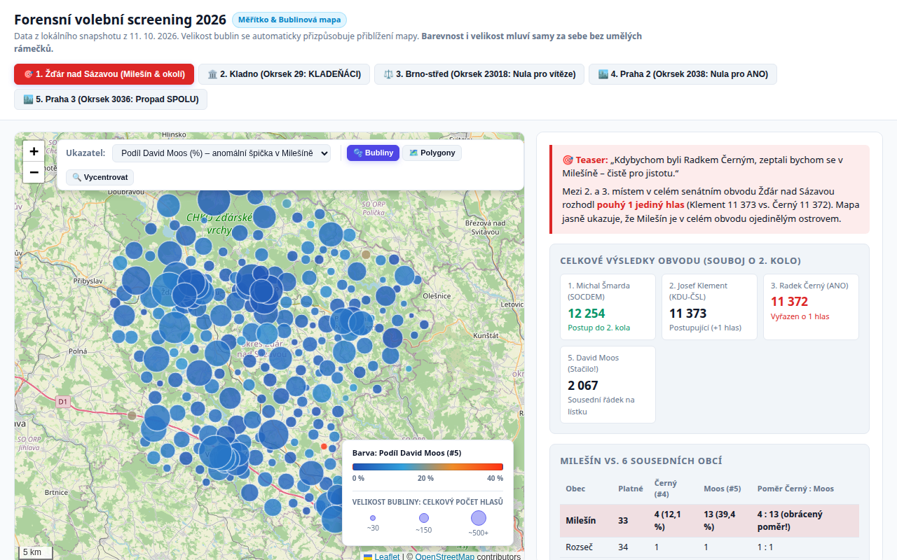
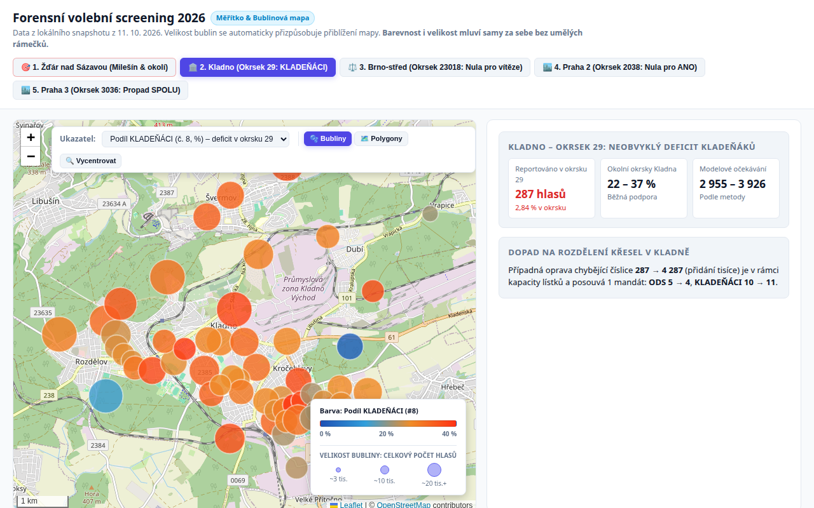
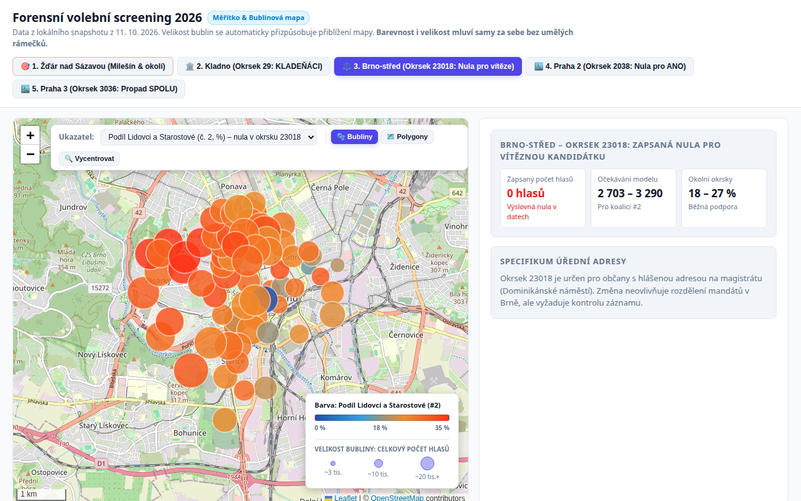
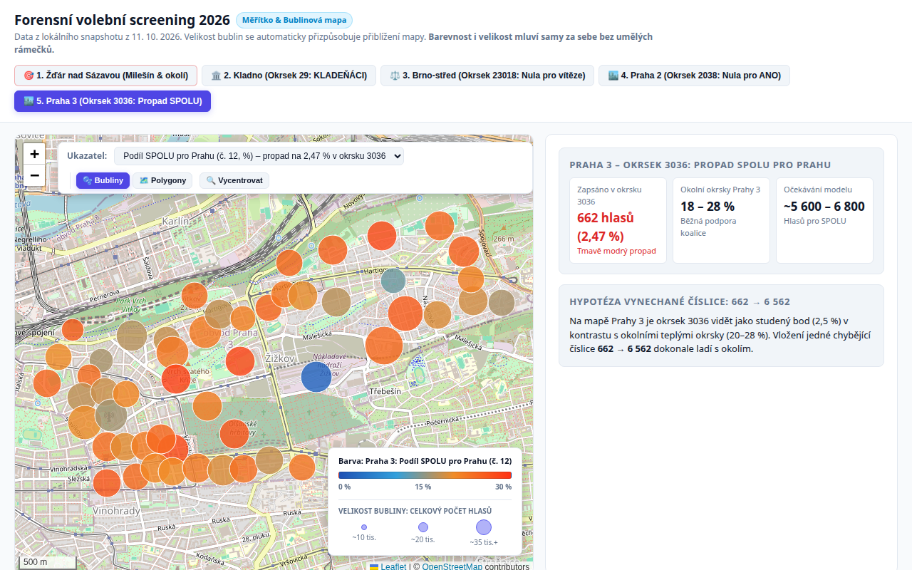

Jedenáct tisíc tři sta sedmdesát tři ku jedenácti tisícům tři sta sedmdesáti dvěma. O tom, kdo postoupí do druhého kola senátních voleb v obvodu č. 51 Žďár nad Sázavou, rozhodl v sobotu 10. října jediný platný hlas. Dosavadní senátor Josef Klement (KDU-ČSL) postoupil s 11 373 hlasy, lékař Radek Černý (ANO) skončil třetí s 11 372 hlasy. V celé republice nebyl těsnější výsledek.

Když se však podíváme na detailní okrsková data, v malé obci Milešín kousek od Velkého Meziříčí se odehrálo něco mimořádného. Z 33 odevzdaných hlasů jich rovných 13 (39,4 %) získal David Moos za koalici Stačilo!. V celém senátním obvodu přitom Moos dostal 5,4 % a v šesti bezprostředně sousedících vesnicích dohromady 6,3 %. Naopak celkový vítěz prvního kola Michal Šmarda (SOCDEM) získal v Milešíně pouhé 3 hlasy (9,1 %), přestože v sousedních obcích bral v průměru 35,2 %.

<RelatedArticles preset="sidebar" position="right" heading="🔻🔻🔻" slugs={["volby-cr-2026-10-10-senat-komunalni-2026-predikce-vysledky", "analyza-2026-10-12-kdo-zustal-doma-komunalni-senat"]} />Český volební systém stojí na desetitisících dobrovolníků v okrskových volebních komisích. Po uzavření místností sčítají papírové lístky, dělají čárky na archy a výsledná čísla přepisují do oficiálního zápisu. Český statistický úřad provádí přísné formální kontroly: zkontroluje, zda součet hlasů pro kandidáty nepřevyšuje počet obálek a zda souhlasí počty voličů. Žádný algoritmus ČSÚ ale nekontroluje věcnou věrohodnost. Pokud komise omylem prohodí sousední řádky na sčítacím archu nebo při přepisu vynechá tisícovku, systém data bez varování přijme a započte do celostátního součtu.

Provedli jsme statistický screening všech 21 670 okrskových výsledků letošních senátních a komunálních voleb. Pomocí statistických modelů a srovnání s geografickými sousedy jsme hledali extrémní odchylky: nuly u silných stran, propady na zlomek běžné podpory i nevysvětlitelné špičky. Žádný protokol jsme fyzicky neviděli a netvrdíme, že jde o volební podvod. Data ale ukazují na konkrétní místa, kde je vysoce pravděpodobná lidská chyba a kde by stálo za to nahlédnout do originálních papírů.

## Milešín: Záhada prohozených čísel a souboj o Senát

V obci Milešín přišlo k senátním volbám 33 voličů. Když jejich hlasy porovnáme s výsledky ve všech šesti přímo sousedících obcích (Březí, Heřmanov, Radňoves, Rozseč, Skřinářov a Vidonín, kde dohromady hlasovalo 378 voličů), vyvstane zřetelný obraz:

| Kandidát | Milešín (33 hlasů) | 6 okolních obcí (378 hlasů) | Stav v Milešíně |
| :--- | :---: | :---: | :--- |
| **#1 Radek Koten** (SPD) | 3 (9,1 %) | 72 (19,0 %) | V běžném rozptylu |
| **#2 Josef Klement** (KDU-ČSL) | 10 (30,3 %) | 106 (28,0 %) | Přesně odpovídá okolí |
| **#3 Michal Šmarda** (SOCDEM) | **3 (9,1 %)** | **133 (35,2 %)** | **Strmý propad (deficit ~8–9 hlasů)** |
| **#4 Radek Černý** (ANO) | **4 (12,1 %)** | **43 (11,4 %)** | **Přesně odpovídá okolí (bez deficitu)** |
| **#5 David Moos** (Stačilo!) | **13 (39,4 %)** | **24 (6,3 %)** | **Extrémní anomálie (přebývá ~11 hlasů)** |

<SupportBanner float="left" />Z tabulky plynou dva klíčové poznatky. Za prvé: Radek Černý v Milešíně žádný viditelný deficit nemá. Jeho zisk 12,1 % prakticky přesně kopíruje okolní vesnice (11,4 %). Za druhé: ten, komu v Milešíně reálně chybějí hlasy, je Michal Šmarda. V okolí získával od 34 do 46 % hlasů (Březí 36,4 %, Heřmanov 34,2 %, Radňoves 45,7 %, Vidonín 38,5 %). Zisk pouhých 3 hlasů je v tomto regionu statisticky těžko uvěřitelný.

Nabízejí se dvě konkurenční hypotézy, jak mohlo k chybě dojít:

1. **Záměna čísel 3 a 13 mezi řádky #3 a #5:** Šmarda kandidoval s číslem 3 a má zapsány 3 hlasy. Moos kandidoval s číslem 5 a má zapsáno 13 hlasů. Pokud zapisovatel komise čísla prohodil (Šmarda 13 a Moos 3), Šmarda by měl 39,4 % a Moos 9,1 %. Obě anomálie by naráz zmizely a rozložení všech pěti kandidátů by dokonale zapadlo mezi okolní obce. V takovém případě by Černý zůstal na 4 hlasech a Klement by regulérně postoupil.
2. **Záměna na sousedních řádcích #4 a #5:** Černý (#4) a Moos (#5) byli bezprostředními sousedy na hlasovacím lístku i na sčítacím formuláři. Pokud komise přepsala hodnoty 4 a 13 mezi těmito dvěma řádky, Černému by naskočilo +9 hlasů (z 4 na 13). Těchto 9 hlasů by stačilo na to, aby Černý přeskočil Klementa a postoupil do 2. kola. Tato hypotéza však ponechává zcela nevysvětlený propad Šmardy.



*Okrsek Milešín na mapě Žďárska: David Moos má v celém obvodu stabilně pod 8 % hlasů (modré bubliny), v Milešíně však svítí s 39,4 % jako osamocený červený bod.*

Zda 13 hlasů v Milešíně patřilo Šmardovi, nebo Černému, žádný model ze své podstaty nerozhodne. Kdybychom ale byli Radkem Černým, v Milešíně bychom se pro jistotu zeptali a požádali soud o přepočítání.

---

## Kladno: Okrsek 29 a chybějící tisícovka hlasů

V Kladně se při komunálních volbách rozdělovalo 33 křesel v městském zastupitelstvu. Výsledky byly velmi těsné: vítězné hnutí KLADEŇÁCI primátora Milana Volfa získalo 10 mandátů, ODS 5 mandátů. 

V okrsku č. 29 na sídlišti Kročehlavy (budova ZŠ Pařížská) odevzdali voliči celkem 10 093 platných hlasů. KLADEŇÁCI (kandidátka č. 8) zde však podle oficiálního zápisu ČSÚ získali pouhých **287 hlasů (2,84 %)**. Ve všech ostatních 56 kladenských okrscích se přitom podpora hnutí pohybovala mezi 22 a 37 %. 



*Okrsek 29 v Kladně-Kročehlavech: zatímco v celém městě mají KLADEŇÁCI 22–37 % (oranžové a červené bubliny), v okrsku 29 svítí hluboký modrý propad na 2,84 %.*

Modelové očekávání pro tento okrsek činí zhruba 2 955 až 3 926 hlasů. Celková kapacita odevzdaných lístků v okrsku přitom bezpečně umožňuje hypotézu vynechané číslice: zápis **287 místo 4 287** hlasů (přidání jedné čtyřky na začátek). 

A co je podstatné: přepočet d’Hondtovou formulí ukazuje, že oprava tohoto jediného okrsku by **přesunula 1 mandát v zastupitelstvu Kladna** – hnutí KLADEŇÁCI by posílilo z 10 na 11 mandátů, zatímco ODS by klesla z 5 na 4 mandáty.

---

## Brno-střed: Zapsaná nula pro vítěze voleb

V Brně zvítězila v celoměstských volbách do zastupitelstva města koalice Lidovci a Starostové (kandidátka č. 2). V okrsku č. 23018 v městské části Brno-střed však v kolonce této kandidátky svítí čistá **0 hlasů**.

Všech ostatních 69 okrsků městské části hlásí pro tuto koalici stabilní podporu mezi 18 a 27 %. Model pro okrsek 23018 očekával přibližně 2 703 až 3 290 hlasů. 



*Dominikánské náměstí v Brně: okrsek 23018 je na mapě jediným tmavomodrým bodem s nulou uprostřed kompaktního oranžového pole.*

Tento okrsek má specifické postavení: jde o volební místnost určenou pro občany s úřední adresou hlášenou na radnici (Dominikánské náměstí 1). I když zdejší voličská struktura bývá specifická, absolutní nula u vítězné celoměstské kandidátky působí jako zřejmá chyba zápisu. Na rozdělení mandátů v 55členném brněnském zastupitelstvu by případná oprava neměla vliv, případ ale ilustruje, jak systémem ČSÚ bez povšimnutí projde i výslovná nula.

---

## Praha 2 a Praha 3: Výslovná nula i propad na dvě procenta

Podobné nesrovnalosti odhalila data i v hlavním městě při volbách do Zastupitelstva hl. m. Prahy:

* **Praha 2, okrsek 2038 (Vinohrady):** Hnutí ANO 2011 (kandidátka č. 22) zde má zapsáno rovných **0 hlasů (0,0 %)**. Ve všech ostatních 40 okrscích Prahy 2 přitom podpora ANO spolehlivě kolísá mezi 7,5 a 15,4 % (průměr 8,8 %). Modelové očekávání pro okrsek 2038 je 2 150 až 2 600 hlasů.
* **Praha 3, okrsek 3036 (Žižkov):** Koalice SPOLU pro Prahu (kandidátka č. 12) zde podle zápisu obdržela pouze **662 hlasů (2,47 %)**. Na celém Žižkově a Vinohradech se přitom podpora koalice stabilně drží mezi 18 a 28 % (průměr 21,0 %). Model pro tento okrsek očekával 5 600 až 6 800 hlasů. Pokud by komise při přepisu vynechala úvodní číslici (zápis **662 místo 6 562**), výsledek by přesně odpovídal sousedním okrskům.



*Okrsek 3036 na Žižkově: zatímco okolní okrsky Prahy 3 vykazují podporu SPOLU kolem 20–25 % (teplé barvy), okrsek 3036 tvoří izolovaný studený bod.*

V obou pražských případech by oprava čísla nezměnila rozdělení 65 mandátů na pražském magistrátu, protože celkový počet odevzdaných hlasů v Praze přesahuje 2,5 milionu. Případy však dokládají, že k anomáliím dochází i ve velkých městských okrscích.

---

## Prozkoumejte data sami na interaktivní mapě

Všech pět popsaných případů si můžete podrobně prohlédnout v interaktivní mapě. V mapě lze přepínat mezi jednotlivými volebními obvody, měnit zobrazované ukazatele, přibližovat jednotlivé okrsky a rozkliknout detail každé volební místnosti. Velikost bublin odpovídá celkovému počtu hlasů v okrsku, barva podílu zkoumané kandidátky:

<HtmlEmbed file="anomalie-mapa.html" />

---

```infobox info
### Jak jsme anomálie hledali a kde jsou limity dat

Pracovali jsme s kompletním lokálním snapshotem otevřených dat Českého statistického úřadu ([volby.gov.cz](https://volby.gov.cz)) ze dne 11. října 2026. Databáze obsahuje 21 670 okrskových výsledků a 147 638 záznamů o hlasech pro kandidáty a strany.

Pro každý okrsek jsme spočítali očekávanou podporu kandidátky pomocí statistických modelů zohledňujících chování voličů v daném regionu a v minulých volbách. Následně jsme identifikovali okrsky s největšími reziduálními odchylkami (rozdílem mezi hlášeným výsledkem a očekáváním) a podrobili je testu citlivosti: zda by jednoduchá typografická chyba (vynechaná číslice, překlep o tisíc, záměna sousedních řádků na kandidátce) vysvětlila anomálii a zda by měla vliv na rozdělení mandátů či postup do 2. kola.

**Zásadní metodické upozornění:** Statistická anomálie není důkazem záměrné manipulace ani podvodu. Ve drtivé většině případů jde o lidské selhání: únavu členů komise po celodenním sčítání, překlep při sčítání čárek nebo nepozornost při přepisu čísel do počítače. 

Podle platného volebního zákona mohou kandidáti a politické strany napadnout platnost hlasování či volby u příslušného krajského soudu (u komunálních voleb) nebo Nejvyššího správního soudu (u voleb do Senátu) ve lhůtě **10 dnů od vyhlášení celkových výsledků**. Soud má pravomoc nechat sporné volební pytle otevřít a hlasy fyzicky přepočítat.
```

<RelatedArticles heading="🔻🔻🔻" slugs={["volby-cr-2026-10-10-senat-komunalni-2026-predikce-vysledky", "analyza-2026-10-12-kdo-zustal-doma-komunalni-senat"]} />
