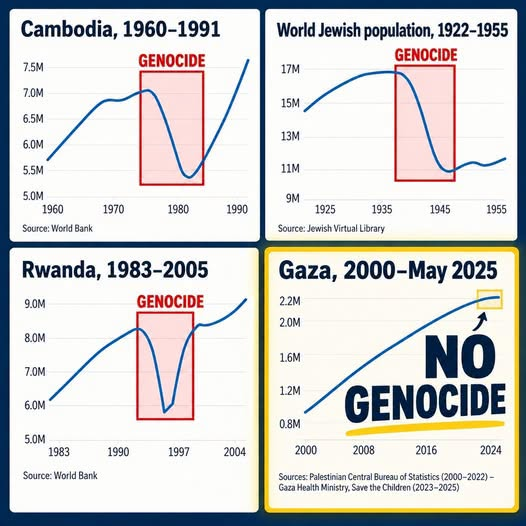

Po sociálních sítích se šíří graf ze čtyř panelů. V Kambodži v letech 1975–1979, ve Rwandě v roce 1994 a u světové židovské populace za holokaustu křivka počtu obyvatel prudce padá a nad propadem svítí červený rámeček s nápisem „genocida“. Ve čtvrtém panelu, Gaza 2000–2025, čára stoupá až k 2,2 milionu a přes ni stojí velké žluté „NO GENOCIDE“. Argument zní: kde lidí přibývá, nemůže probíhat genocida.

Graf má tři chyby. Měří něco, s čím právní definice genocidy nepočítá. Vynechává uznané genocidy, při kterých počet obyvatel rostl dál. A čísla za Gazu z doby války nejsou měření, ale předválečná projekce: podle odhadů Palestinského statistického úřadu (PCBS) lidí v Gaze za válku ubylo. Kdo graf vytvořil, se nám dohledat nepodařilo. Stejný argument ale už v prosinci 2024 vyvrátily australská redakce [AAP FactCheck](https://www.aap.com.au/factcheck/gaza-population-growth-projections-predate-recent-israel-palestine-war/) a americký web [PolitiFact](https://www.politifact.com/factchecks/2024/dec/06/instagram-posts/has-gazas-population-grown-2-since-oct-7-2023-no-t/).

## Úmluva o genocidě se na počet obyvatel neptá

Genocidu definuje [Úmluva o zabránění a trestání zločinu genocidia](https://www.zakonyprolidi.cz/cs/1955-32) z roku 1948, kterou Československo přijalo v roce 1951. Podle jejího článku II jde o činy „spáchané v úmyslu zničit úplně nebo částečně některou národní, ethnickou, rasovou nebo náboženskou skupinu jako takovou“. Úmluva vyjmenovává pět takových činů: usmrcení příslušníků skupiny, těžké ublížení na těle nebo duševní zdraví, uvedení skupiny do životních podmínek, které ji mají fyzicky zničit, opatření bránící rození dětí a násilné převádění dětí do jiné skupiny.

<RelatedArticles preset="sidebar" slugs={["kontext-2026-10-27-komise-osn-zlociny-proti-lidskosti-na-zapadnim-brehu","analyza-2026-08-10-izraelsko-palestinsky-konflikt","analyza-2026-09-29-mapy-ukazuji-jak-se-promenila-gaza"]} position="right" heading="🔻🔻🔻" />Genocidu tedy určují dvě věci: co se skupině děje a s jakým úmyslem. Kdo zabíjí lidi ve velkém, ničí jejich podmínky k životu nebo jim brání mít děti, a dělá to proto, aby skupinu zničil, naplňuje definici. O žádné hranici počtu obětí ani o úbytku obyvatel úmluva nemluví. Trestný je podle ní i pokus a přímé a veřejné podněcování ke genocidě.

Soudy to v praxi potvrdily. Mezinárodní trestní tribunál pro bývalou Jugoslávii v [odvolacím rozsudku ve věci Krstić](https://www.icty.org/x/cases/krstic/acjug/en/krs-aj040419e.pdf) z roku 2004 uznal za genocidu vraždu sedmi až osmi tisíc mužů a chlapců ze Srebrenice. Cílenou „podstatnou částí“ skupiny bylo podle tribunálu asi 40 tisíc bosenských muslimů z enklávy, ne všichni Bosňáci. Tribunál také napsal, že ani neúspěch pachatele genocidní úmysl nevylučuje. Vyšetřovací komise OSN to ve [své právní analýze](https://www.un.org/unispal/document/commission-of-inquiry-report-genocide-in-gaza-a-hrc-60-crp-3/) shrnuje větou, že „úmysl zničit“ neznamená, že ke zničení musí dojít.

Masové zabíjení samo o sobě genocidou být nemusí. Když chybí úmysl zničit skupinu jako takovou, mluví mezinárodní právo o zločinech proti lidskosti, třeba o vyhlazování. Rozsah zabíjení přitom soudy sledují: Mezinárodní soudní dvůr v [rozsudku Chorvatsko proti Srbsku](https://www.icj-cij.org/case/118) z roku 2015 bral v úvahu i to, kolik obětí bylo ve srovnání s velikostí cílené skupiny, a úmysl dovozuje jen tehdy, když je to jediný rozumný závěr z celkového jednání. Počet obětí je tedy jedno z vodítek k úmyslu. Celkový počet obyvatel, který kromě zabitých zahrnuje i nově narozené a lidi, kteří odešli, mezi taková vodítka nepatří.

## Uznané genocidy, které na křivce obyvatel nejsou vidět

Kdyby platil test z grafu, musela by počet obyvatel snížit každá genocida. Data Světové banky, která graf sám cituje, ukazují opak.

<VegaChart dataFile="data/krivky-obyvatel.json" />

<SupportBanner float="left" />V roce 2014 bojovníci Islámského státu v iráckém Sindžáru zabili podle [studie v časopise PLOS Medicine](https://journals.plos.org/plosmedicine/article?id=10.1371/journal.pmed.1002297) asi 3 100 Jezídů a 6 800 jich unesli, převážně ženy a děti. Vyšetřovací komise OSN to v roce 2016 ve zprávě „They came to destroy“ označila za genocidu a v listopadu 2021 za ni [vrchní zemský soud ve Frankfurtu poprvé odsoudil](https://www.amnesty.org/en/latest/news/2021/11/germany-iraq-worlds-first-judgment-on-crime-of-genocide-against-the-yazidis/) bývalého člena Islámského státu, Iráčana Tahu Al-J. Počet obyvatel Iráku mezitím rostl z 35,3 milionu v roce 2013 na 38,5 milionu v roce 2016.

Podobně v Myanmaru. Při takzvaných čisticích operacích armády v roce 2017 zahynulo podle [vyšetřovací mise OSN](https://digitallibrary.un.org/record/1648304) přes deset tisíc Rohingů (odhad deseti tisíc mise označila za opatrný) a téměř 725 tisíc jich do srpna 2018 uprchlo do Bangladéše. Mise doporučila stíhat velení armády pro genocidu a spor Gambie proti Myanmaru teď projednává Mezinárodní soudní dvůr. Celkový počet obyvatel Myanmaru přesto rostl dál. V Guatemale označila komise pravdy podporovaná OSN zabíjení mayských Ixilů v letech 1981–1983 za genocidní činy. Země měla v roce 1980 6,9 milionu obyvatel a v roce 1984 7,6 milionu.

Zbylé tři panely grafu ze sítí ukazují případy, kdy pachatelé zavraždili velkou část celé populace, nebo kdy do propadu spadli i uprchlíci. Ve Rwandě ubylo mezi lety 1993 a 1995 podle Světové banky 2,3 milionu lidí. Genocida si podle [Úřadu vysokého komisaře OSN pro uprchlíky](https://www.unhcr.org/africa/3ebf9bb60.html) vyžádala asi 800 tisíc životů a přes dva miliony lidí uprchly do Zairu, Tanzanie, Burundi a Ugandy. Propad na křivce tak ze značné části tvoří uprchlíci a s jejich návratem se počet obyvatel během čtyř let vrátil na předválečnou úroveň.

V Kambodži zemřelo za vlády Rudých Khmerů v letech 1975–1979 kolem 1,7 milionu lidí, asi pětina obyvatel. Mezinárodně podporovaný tribunál ECCC ale v [rozsudku z roku 2018](https://www.internationalcrimesdatabase.org/Case/3311) uznal za genocidu jen zabíjení vietnamské menšiny a muslimských Čamů. Většinu obětí, Khmery zabité vlastním režimem, posoudil jako zločiny proti lidskosti. Graf ze sítí tedy jako vzor genocidy používá případ, kde právně genocidou byla jen menší část zabíjení.

Panel o holokaustu ukazuje světovou židovskou populaci podle [Jewish Virtual Library](https://www.jewishvirtuallibrary.org/jewish-population-of-the-world): 16,7 milionu v roce 1939 a 11 milionů v roce 1945. Nacistické Německo a jeho spojenci zavraždili šest milionů Židů z asi 9,5 milionu, kteří podle [Muzea holokaustu ve Washingtonu](https://encyclopedia.ushmm.org/content/en/article/jewish-population-of-europe-in-1933-population-data-by-country) žili v roce 1933 v Evropě. Slovo genocida vytvořil právník Raphael Lemkin v roce 1944 pro zločiny nacistického Německa a úmluva z roku 1948 vznikla jako odpověď na holokaust. Tak velkou část skupiny ale zasáhla jen málokterá genocida.

## Genocidou byly uznány činy, při nichž zahynulo necelé procento skupiny

Srovnání ukazuje, jak různý může být rozsah. Ve Rwandě zahynuly asi tři čtvrtiny Tutsiů, v Sindžáru necelé procento Jezídů. Obojí bylo uznáno za genocidu, protože pachatelé chtěli skupinu zničit.

<VegaChart dataFile="data/podil-zavrazdenych.json" />

V Gaze zahynulo od 7. října 2023 do 21. října 2026 podle ministerstva zdravotnictví v Gaze, jehož čísla přebírá [úřad OSN pro humanitární záležitosti OCHA](https://www.ochaopt.org/sites/default/files/Gaza_Reported_Impact_Snapshot_21_October_2026.pdf), 74 494 lidí. To jsou asi 3 % předválečných obyvatel. Ministerstvo podléhá vládě Hamásu a Izrael jeho čísla zpochybňuje. Nezávislý [průzkum dvou tisíc domácností](https://doi.org/10.1016/S2214-109X%2825%2900522-4), který letos publikoval časopis Lancet Global Health, ale došel k vyššímu číslu: do 5. ledna 2025 odhadl 75 200 násilných úmrtí. Ministerstvo jich za stejné období hlásilo 49 090, o třetinu méně. Složení obětí podle věku a pohlaví podle autorů studie odpovídá údajům ministerstva.

Podíl obětí sám o sobě nerozhoduje ani jedním směrem. Necelé procento v Sindžáru genocidu nevylučuje a tři procenta v Gaze ji nedokazují. Rozhoduje úmysl a činy, ze kterých se dá vyčíst.

## V Gaze se i za války rodilo víc dětí, než kolik lidí ministerstvo hlásilo zabitých

Proč může počet obyvatel stagnovat, i když umírají desítky tisíc lidí? Protože se do něj započítávají i narozené děti. Obyvatelstvo Gazy je velmi mladé: 47 % lidí je podle PCBS mladších 18 let. V roce 2022 se tam podle [registru obyvatel](https://pcbs.gov.ps/Portals/_Rainbow/Documents/MAINBRD-2022-E.html) narodilo 57 877 dětí, tedy kolem 160 denně.

Populační fond OSN (UNFPA) odhadoval, že v Gaze i během války [rodí asi 180 žen denně](https://www.un.org/unispal/wp-content/uploads/2024/01/unfpa-situation-report-5-24jan.pdf). Ministerstvo zdravotnictví od 7. října 2023 do konce roku 2024 hlásilo 45 541 zabitých, v průměru zhruba sto denně. Porody tak v celkovém součtu ztráty na životech převyšovaly. Válka přesto porodnost srazila: v prvním pololetí 2025 se podle [UNFPA](https://news.un.org/en/story/2025/07/1165471) narodilo 17 tisíc dětí proti 29 tisícům ve stejném období roku 2022, o 41 % méně.

Z Gazy navíc do července 2024 odešlo přes Egypt asi 110 tisíc lidí, uvedla [OCHA](https://www.ochaopt.org/content/humanitarian-situation-update-187-gaza-strip). I tihle lidé z populace ubyli, aniž by zemřeli. Celkový počet obyvatel tedy míchá narozené, zabité a odešlé dohromady. Kdo z něj chce vyčíst, zda probíhá genocida, nevidí, co se děje s lidmi.

## Čísla za válku v grafu nejsou měření, ale předválečná projekce

Za války v Gaze žádné sčítání neproběhlo. Údaje pro roky 2024 a 2025, které kolují po sítích, vycházejí z projekcí spočítaných před 7. říjnem 2023, jak ukázala už AAP FactCheck u čísel z databáze CIA World Factbook. Palestinský statistický úřad v předválečné projekci počítal s tím, že Gaza poroste dál o 2,7 % ročně, jako v době míru. Tuhle stoupající čáru graf ze sítí kreslí. Že by odhad počtu obyvatel zveřejnilo ministerstvo zdravotnictví v Gaze nebo organizace Save the Children, které graf uvádí jako zdroj pro roky 2023–2025, se nám dohledat nepodařilo.

<VegaChart dataFile="data/gaza-projekce-odhad.json" />

Palestinský statistický úřad během války svou projekci opravuje. K polovině roku 2023 počítal s 2,23 milionu obyvatel Gazy. Ke konci roku 2025 jich podle [jeho odhadu](https://www.pcbs.gov.ps/portals/_pcbs/PressRelease/Press_En_PalPeopleEnd2025E.pdf) žilo 2,13 milionu. Úřad uvádí úbytek 254 tisíc lidí neboli 10,6 %. Počítá ho ale proti předválečné projekci, tedy proti tomu, kolik lidí by v Gaze žilo bez války. Proti skutečnému počtu z poloviny roku 2023 jde o úbytek zhruba sto tisíc lidí, asi 4 %. Jako příčiny PCBS jmenuje zabíjení, odchody z Gazy a pokles porodnosti. I tyto odhady jsou nejisté: podle PCBS muselo z 2,2 milionu obyvatel opustit domov kolem dvou milionů a spočítat je nikdo nemůže.

Graf ze sítí tedy neukazuje, co se v Gaze stalo, ale co se čekalo, že se stane bez války. I opatrnější verze téhož argumentu, kterou letos 13. října na síti X použil britský historik [Simon Schama](https://x.com/simon_schama/status/2109985922024390879), stojí na počtu obyvatel: z úbytku o 4,55 % vyvodil, že nejde o genocidu. Úmluva ale žádnou hranici úbytku nestanoví a genocida Jezídů postihla necelé procento skupiny.

## Kdo tvrdí, že jde o genocidu, a kdo to odmítá

Závazně rozhodne Mezinárodní soudní dvůr ve sporu [Jihoafrická republika proti Izraeli](https://www.icj-cij.org/case/192). V lednu 2024 soud uznal, že Palestinci v Gaze mají věrohodné právo na ochranu před genocidou, a nařídil Izraeli předběžná opatření, mimo jiné zabránit činům podle úmluvy a umožnit humanitární pomoc. Tehdejší předsedkyně soudu Joan Donoghue později v rozhovoru pro BBC upozornila, že soud tím nerozhodl, že genocida věrohodně probíhá. Rozsudek ve věci samé zatím nepadl a podle [harmonogramu z května 2026](https://www.un.org/unispal/document/icj-court-order-on-fixing-of-time-limits-reply-and-rejoinder-south-africa-v-israel/) podá Jihoafrická republika další písemné vyjádření do listopadu 2027 a Izrael do května 2029. Do sporu se zapojilo 21 států, mimo jiné Španělsko, Irsko a Belgie, ale i USA, které podle médií ve svém podání tvrdí, že Izraeli chybí genocidní úmysl.

Mezinárodní trestní soud vydal v listopadu 2024 [zatykače na premiéra Benjamina Netanjahua a bývalého ministra obrany Joava Galanta](https://www.icc-cpi.int/news/situation-state-palestine-icc-pre-trial-chamber-i-rejects-state-israels-challenges). Znějí na válečné zločiny, mezi nimi hladovění jako metodu vedení války, a na zločiny proti lidskosti. Genocida mezi nimi není.

K závěru, že Izrael v Gaze genocidu páchá, došla v září 2025 Nezávislá mezinárodní vyšetřovací komise OSN, tehdy pod vedením Navi Pillay. Shledala čtyři z pěti činů z úmluvy a genocidní úmysl označila za jediný rozumný závěr z celku důkazů, včetně výroků prezidenta Jicchaka Herzoga, premiéra Netanjahua a tehdejšího ministra obrany Galanta. Komise v novém složení pod vedením Srinivasana Muralidhara letos v říjnu uvedla, že genocida pokračuje i po příměří z října 2025. Podrobně jsme o zprávě psali v článku [Vyšetřovatelé OSN viní Izrael z vyhlazování Palestinců na Západním břehu](/clanek/kontext-2026-10-27-komise-osn-zlociny-proti-lidskosti-na-zapadnim-brehu).

Ke stejnému závěru došly [Amnesty International](https://www.amnesty.org/en/latest/news/2024/12/amnesty-international-concludes-israel-is-committing-genocide-against-palestinians-in-gaza/) v prosinci 2024, izraelské organizace B'Tselem a Lékaři za lidská práva – Izrael v červenci 2025 a [Mezinárodní asociace badatelů o genocidě](https://genocidescholars.org/reactions-to-iags-resolution-on-gaza/) v září 2025, kdy pro rezoluci hlasovalo 86 % hlasujících členů. [Human Rights Watch](https://www.hrw.org/news/2024/12/19/israels-crime-extermination-acts-genocide-gaza) formulovala opatrněji: odpírání vody označila za vyhlazování a za genocidní činy.

Izrael obvinění odmítá. Podle jeho [mise při OSN v Ženevě](https://embassies.gov.il/ungeneva/en/news/16-09-2025) chce zničit Hamás, vynakládá úsilí, aby civilistům co nejméně ublížil, a umožňuje humanitární pomoc. Komisi vyčítá, že přehlíží zločiny Hamásu a opírá se o jeho údaje. Izraelská vláda se odvolává i na [studii centra BESA](https://besacenter.org/wp-content/uploads/2025/09/213-2.9.2025.pdf) při Bar-Ilanově univerzitě, podle níž chybí důkazy o systematické politice zabíjení civilistů. Německo, které v lednu 2024 obvinění rázně odmítlo, v září 2025 po zprávě komise uvedlo, že právní hodnocení přísluší soudům, a letos v březnu oznámilo, že do sporu u Mezinárodního soudního dvora nevstoupí.

Až Mezinárodní soudní dvůr bude rozhodovat, bude podle své dosavadní judikatury posuzovat výroky politiků a velitelů, rozkazy, blokádu humanitární pomoci, ničení nemocnic a vzorec útoků na civilisty. Bude zkoumat, co se dělo s lidmi v Gaze a proč. Křivku počtu obyvatel posuzovat nebude.

<RelatedArticles heading="🔻🔻🔻" slugs={["kontext-2026-10-27-komise-osn-zlociny-proti-lidskosti-na-zapadnim-brehu","analyza-2026-08-10-izraelsko-palestinsky-konflikt","analyza-2026-09-29-mapy-ukazuji-jak-se-promenila-gaza","analyza-2026-08-25-evropske-soudy-a-nenavist-palestinci-izraelci","kontext-2026-09-18-nemocnice-al-ahli-vizualni-investigace","explainer-2026-02-18-jak-zmanipulovane-video-rozhybalo-pet-evropskych-vlad"]} />
